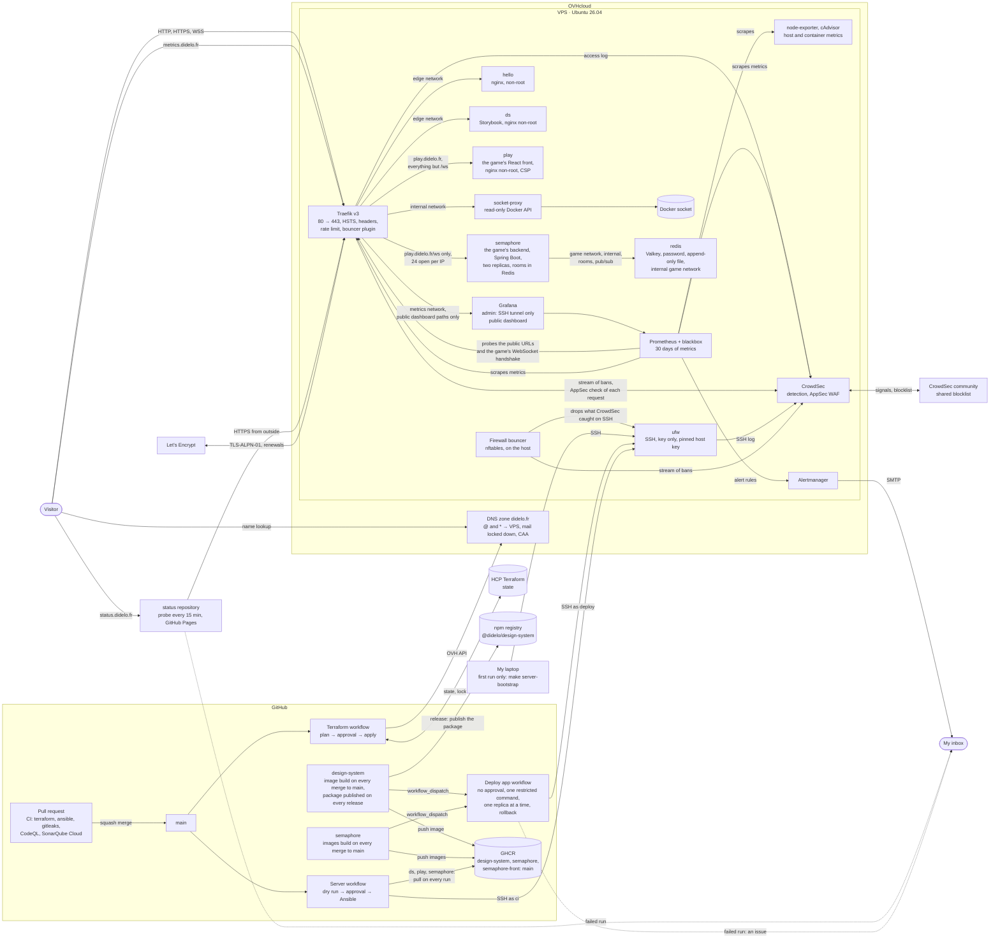

# infra

[](https://github.com/Didelo-lilian/infra/releases)
[](https://github.com/Didelo-lilian/infra/actions/workflows/ci.yml)
[](LICENSE)
[](https://www.ssllabs.com/ssltest/analyze.html?d=hello.didelo.fr&latest)
[](https://securityheaders.com/?q=hello.didelo.fr&followRedirects=on)

My personal production platform: one VPS, everything as code, every project deployed to production from CI.

> **Status:** DNS, server and HTTPS edge are live ([hello.didelo.fr](https://hello.didelo.fr)), next is monitoring. Follow the [roadmap](https://github.com/orgs/Didelo-lilian/projects/1).

## What it will run

| Layer | Choice |
|---|---|
| Server | OVHcloud VPS, configured and hardened by an Ansible playbook |
| DNS | `didelo.fr` zone fully managed by Terraform |
| Edge | Traefik v3, HTTPS everywhere with automatically renewed Let's Encrypt certificates, WAF and anti-bot |
| Observability | Prometheus, Grafana, one uptime probe per project, public status page |
| CI/CD | Pull requests on GitHub-hosted runners, deploys from `main` on ephemeral self-hosted runners |
| Secrets | SOPS + age, decrypted by the CI ([ADR 0007](docs/adr/0007-secrets-with-sops-and-age.md)) |

## Architecture

What runs today. The diagram is updated in the same pull request as any change it shows.



### Intrusion detection

[`stacks/crowdsec`](stacks/crowdsec/compose.yaml) ([ADR 0010](docs/adr/0010-crowdsec-reads-the-edge-logs.md)): **CrowdSec** reads the Traefik access log and the SSH log and raises an alert for scans, probes and brute force. A bouncer plugin in Traefik ([ADR 0011](docs/adr/0011-the-traefik-bouncer-fails-open.md)) answers 403 to the banned IPs, and lets everything through if CrowdSec is down. A firewall bouncer on the host ([ADR 0012](docs/adr/0012-ban-ssh-attackers-at-the-host-firewall.md)) drops the addresses CrowdSec caught attacking SSH. **AppSec**, CrowdSec's WAF ([ADR 0013](docs/adr/0013-a-waf-in-the-edge-that-fails-open.md)), checks each request against the virtual-patching rules and the OWASP Core Rule Set and answers 403 to SQL injections, path traversals and known exploits; it fails open too.

### Grades

The two badges at the top are static: they say what the live reports (the links) gave on 2026-10-24 for `hello.didelo.fr`, an A+ on [SSL Labs](https://www.ssllabs.com/ssltest/analyze.html?d=hello.didelo.fr&latest) (TLS 1.2 minimum, strict SNI, HSTS) and an A+ on [securityheaders.com](https://securityheaders.com/?q=hello.didelo.fr&followRedirects=on). Reaching the second one took two changes, a `Permissions-Policy` for every site and a CSP for hello; Storybook (ds) has none yet because it needs a far looser policy that has to be tested on its own.

**HSTS preload** is deliberately not used: [hstspreload.org](https://hstspreload.org/?domain=didelo.fr) reports `didelo.fr` as unknown, and it would also fail the check, because the apex has no certificate (Traefik serves `*.didelo.fr` subdomains with strict SNI) and the header has no `preload` directive. Preloading puts the whole domain in browsers' lists for months, including every future subdomain, and is hard to undo: it is a decision to take when every subdomain is stable, not before.

### Monitoring

[`stacks/monitoring`](stacks/monitoring/compose.yaml) ([ADR 0006](docs/adr/0006-monitoring-and-public-status-page.md)):
- **Prometheus** scrapes the server (node-exporter) and, through a **blackbox exporter**, probes every public URL as a visitor would: availability, latency and certificate expiry. The game gets a second probe, the WebSocket handshake of `wss://play.didelo.fr/ws` through the edge (a `tcp` probe over TLS that passes on a `101`). Alert rules live in [`rules.yml`](stacks/monitoring/prometheus/rules.yml) and are unit-tested.
- **cAdvisor** adds per-container CPU, memory and restarts to the dashboard, and an alert fires when a container restarts three times in 15 minutes, when Redis has been gone for 2 minutes and when the game's backend has fewer than two replicas for 5 minutes.
- **CrowdSec and Traefik** are scraped over the private `crowdsec` network (their metrics ports are published nowhere). The **Security** dashboard in Grafana shows active bans by origin, the requests Traefik refused (403 and 429), the WAF's inspected and blocked requests, the rules that fired and the addresses blocked, and how many log lines CrowdSec reads and parses. The `CrowdSecNotParsing` alert fires when it has read no line of the access log for 15 minutes; the status probes alone write one every few seconds. The addresses on the dashboard stay private.
- **Alertmanager** emails the alerts through a Gmail SMTP relay, so `didelo.fr` itself still sends no mail.
- **Grafana** is my detailed view, reachable through an SSH tunnel only (`make grafana`, then http://localhost:3000). Its datasource and dashboards are provisioned from files, so a change goes through a pull request.
- A **public dashboard** at https://metrics.didelo.fr ([ADR 0014](docs/adr/0014-a-public-metrics-dashboard-from-grafana.md)) shows what a visitor can already see plus the global load: availability, response time, certificate expiry, CPU and memory. Traefik routes only that dashboard's paths and answers 404 to the rest of Grafana. It goes down with the server, so it does not replace the status page.
- The **public status page** is https://status.didelo.fr, served by GitHub Pages from the [status repository](https://github.com/Didelo-lilian/status), which also probes the site from outside every 15 minutes. A status page hosted on the server it watches would go down with it.

Ports 80 and 443 are published by Docker, which writes its own firewall rules and bypasses ufw: that is why Traefik is the only container that publishes ports.

Every choice gets a short decision record in [`docs/adr/`](docs/adr/) as it is made.

## Run it

Requirements: Terraform ≥ 1.14, Ansible with ansible-lint, Docker, gitleaks, the GitHub CLI, an HCP Terraform workspace in local execution mode and scoped OVH API credentials.

```bash
make check         # same checks as CI: fmt, validate, tflint, ansible-lint, actionlint, shellcheck, gitleaks
make test-deploy-app   # roll real images out with the real deploy-app on a throwaway stack (needs Docker)
make plan          # preview changes to the real infrastructure
make apply         # apply them, after confirmation
make server-diff   # preview the server configuration (dry run)
make server        # apply it (emergencies: CI does it on main)
make server-bootstrap  # once per fresh server: create the user CI connects with
```

Changes reach production through CI, not from a laptop: once a change to `terraform/` is merged to `main`, the **Terraform** workflow plans it and shows the plan in the run summary, then the apply waits for a manual approval in the protected `production` environment ([ADR 0002](docs/adr/0002-apply-from-ci-with-approval.md)).

`make plan` and `make apply` remain for local previews and emergencies. They read `TF_CLOUD_ORGANIZATION`, `TF_WORKSPACE` and the OVH credentials from an env file kept outside the repo (override its path with `ENV=`), and the GitHub token from `gh auth token`. Nothing secret is committed.

### Secrets
Application secrets live encrypted in `secrets/*.sops.yaml` ([ADR 0007](docs/adr/0007-secrets-with-sops-and-age.md)): [SOPS](https://github.com/getsops/sops) encrypts the values for the keys listed in [`.sops.yaml`](.sops.yaml), and only the CI and my laptop hold a private key. To edit one, run `sops secrets/production.sops.yaml` (the laptop key is read from SOPS's default location). `make check-secrets` fails if anything in `secrets/` is readable, and CI runs it on every pull request. Rotation and recovery are in the [runbook](docs/runbooks/rotate-secrets.md).

### The server

[`ansible/site.yml`](ansible/site.yml) describes the whole server ([ADR 0003](docs/adr/0003-server-configuration-with-ansible.md)):
- key-only SSH, no root login;
- Docker from Ubuntu's packages, with log rotation;
- a `deploy` user;
- a firewall that only lets SSH, HTTP and HTTPS in;
- automatic security updates, with a reboot at 04:00 UTC when one needs it.
- the Docker stacks in [`stacks/`](stacks/), started with Docker Compose.

### The edge

[`stacks/traefik`](stacks/traefik/compose.yaml) runs Traefik, the only container that publishes ports ([ADR 0004](docs/adr/0004-traefik-with-tls-challenge.md)):
- HTTP redirects to HTTPS, and every response carries HSTS and security headers, with the `Server` header stripped so no backend version leaks;
- each client IP is limited to **30 requests per second on average with a burst of 100**, and to **50 requests open at once** (`rate-limit` and `in-flight`, [`limits.yml`](stacks/traefik/dynamic/limits.yml); `in-flight` groups by request host unless told otherwise, so its criterion is the IP on purpose, [ADR 0015](docs/adr/0015-the-game-behind-the-edge.md)); beyond that Traefik answers 429. A page and its assets are a few dozen requests at most (Storybook's story page is about a dozen), so normal browsing, the status probes (a handful of requests every few minutes) and Storybook stay far below; a bot hammering the site does not. `scripts/burst.sh` sends a burst and counts the statuses: on a local Traefik 80 simultaneous requests all passed and 600 gave 133 answers and 467 429s. The open-request cap also covers WebSockets for as long as they stay open, and `/ws` has a stricter cap of **24 per IP** (two full rooms);
- certificates come from Let's Encrypt through the TLS-ALPN-01 challenge and are renewed automatically, with no DNS credentials on the server;
- Traefik reads containers through a socket proxy that only allows listing them, never the Docker socket itself;
- an app is published by adding the `traefik.enable` label and a `Host()` rule, as [`stacks/hello`](stacks/hello/compose.yaml) does for https://hello.didelo.fr;
- [`stacks/ds`](stacks/ds/compose.yaml) serves the Storybook of [design-system](https://github.com/Didelo-lilian/design-system) on https://ds.didelo.fr from a public GHCR image whose `main` tag moves with every merge there ([ADR 0008](docs/adr/0008-serve-a-static-site-from-another-repository.md)), restarted by the **Deploy app** workflow without an approval ([ADR 0009](docs/adr/0009-deploy-app-updates-without-approval.md)); the frame header is `SAMEORIGIN`, so a site can embed its own pages but no other site can frame them;
- [`stacks/semaphore`](stacks/semaphore/compose.yaml) and [`stacks/play`](stacks/play/compose.yaml) serve the game, [semaphore](https://github.com/Didelo-lilian/semaphore), on https://play.didelo.fr ([ADR 0015](docs/adr/0015-the-game-behind-the-edge.md)): the backend (Spring Boot, two replicas that share their rooms in Redis, [ADR 0020](docs/adr/0020-two-replicas-of-the-backend.md)) takes `/ws` only, the React front takes the rest with its own Content-Security-Policy, and both are rolled out by **Deploy app** like `ds`. The Spring actuator has no router, so it is not reachable from the internet.

- **Deploys of an app** ([ADR 0019](docs/adr/0019-rolling-and-canary-deploys.md)): [`scripts/deploy-app`](scripts/deploy-app), the one command the **Deploy app** key can run, updates a stack's replicas one at a time. It records the image that runs, pulls once, starts a replica on the new image next to the old ones and waits until it is healthy; with several replicas the first one, the canary, is then watched for two minutes (the soak) for restarts and health before the others follow. A canary that fails puts the previous image back, the run fails and opens an issue. A stack with one replica gets no soak. [`tests/deploy-app`](tests/deploy-app/run.sh) runs it against a throwaway stack, in CI too.

It is idempotent: a second run changes nothing. Like Terraform, it is applied from CI ([ADR 0005](docs/adr/0005-apply-the-server-configuration-from-ci.md)): once a change to `ansible/`, `stacks/` or `scripts/deploy-app` is merged, the **Server** workflow dry-runs it and shows the diff in the run summary, then the real run waits for an approval in `production`. CI connects as `ci` with its own key and refuses any server whose host key differs from [`ansible/known_hosts`](ansible/known_hosts).

From a laptop, the playbook reaches the server through an SSH alias `didelo-vps` defined in `~/.ssh/config` (host, user `ubuntu`, key).

### The game's Redis

[`stacks/redis`](stacks/redis/compose.yaml) runs Valkey, the BSD fork of Redis, for the rooms of the game ([ADR 0018](docs/adr/0018-redis-for-the-games-rooms.md)): image pinned by digest, read-only, no capability, a password from SOPS, an append-only file flushed every second so that a restart keeps the rooms, and `noeviction` under a 64 MiB `maxmemory` so that a full Redis refuses a write instead of dropping a room. It is alone on the internal `game` network (no published port, not on `edge`), which the backend joins when its rooms move there; nothing uses it yet.

## Changelog

Versions follow [SemVer](https://semver.org) and are cut by [release-please](https://github.com/googleapis/release-please) from the Conventional Commit titles of merged pull requests. Never edited by hand:
- [`CHANGELOG.md`](CHANGELOG.md): every release, grouped by type;
- [Releases](https://github.com/Didelo-lilian/infra/releases): notes and tags.

## How I built this

Built incrementally, one weekend at a time, with [Claude Code](https://claude.com/claude-code) as a pair: I write the issues and decisions, review every change and keep the history honest.

## License

[MIT](LICENSE)
