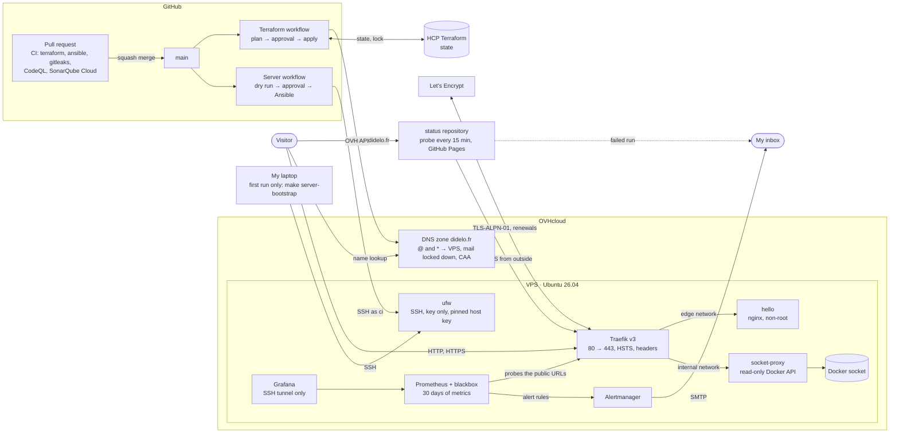

# infra

[](https://github.com/Didelo-lilian/infra/releases)
[](https://github.com/Didelo-lilian/infra/actions/workflows/ci.yml)
[](LICENSE)

My personal production platform: one VPS, everything as code, every project deployed to production from CI.

> **Status:** DNS, server and HTTPS edge are live ([hello.didelo.fr](https://hello.didelo.fr)), next is monitoring. Follow the [roadmap](https://github.com/orgs/Didelo-lilian/projects/1).

## What it will run

| Layer | Choice |
|---|---|
| Server | OVHcloud VPS, configured and hardened by an Ansible playbook |
| DNS | `didelo.fr` zone fully managed by Terraform |
| Edge | Traefik v3, HTTPS everywhere with automatically renewed Let's Encrypt certificates, WAF and anti-bot |
| Observability | Prometheus, Grafana, one uptime probe per project, public status page |
| CI/CD | Pull requests on GitHub-hosted runners, deploys from `main` on ephemeral self-hosted runners |
| Secrets | SOPS + age, pushed to GitHub by Terraform |

## Architecture

What runs today. The diagram is updated in the same pull request as any change it shows.



### Monitoring

[`stacks/monitoring`](stacks/monitoring/compose.yaml) ([ADR 0006](docs/adr/0006-monitoring-and-public-status-page.md)):
- **Prometheus** scrapes the server (node-exporter) and, through a **blackbox exporter**, probes every public URL as a visitor would: availability, latency and certificate expiry. Alert rules live in [`rules.yml`](stacks/monitoring/prometheus/rules.yml) and are unit-tested.
- **Alertmanager** emails the alerts through a Gmail SMTP relay, so `didelo.fr` itself still sends no mail.
- **Grafana** is my detailed view, reachable through an SSH tunnel only. Its datasource and dashboard are provisioned from files, so a change goes through a pull request.
- The **public status page** is https://status.didelo.fr, served by GitHub Pages from the [status repository](https://github.com/Didelo-lilian/status), which also probes the site from outside every 15 minutes. A status page hosted on the server it watches would go down with it.

Ports 80 and 443 are published by Docker, which writes its own firewall rules and bypasses ufw: that is why Traefik is the only container that publishes ports.

Every choice gets a short decision record in [`docs/adr/`](docs/adr/) as it is made.

## Run it

Requirements: Terraform ≥ 1.14, Ansible with ansible-lint, Docker, gitleaks, the GitHub CLI, an HCP Terraform workspace in local execution mode and scoped OVH API credentials.

```bash
make check         # same checks as CI: fmt, validate, tflint, ansible-lint, actionlint, gitleaks
make plan          # preview changes to the real infrastructure
make apply         # apply them, after confirmation
make server-diff   # preview the server configuration (dry run)
make server        # apply it (emergencies: CI does it on main)
make server-bootstrap  # once per fresh server: create the user CI connects with
```

Changes reach production through CI, not from a laptop: once a change to `terraform/` is merged to `main`, the **Terraform** workflow plans it and shows the plan in the run summary, then the apply waits for a manual approval in the protected `production` environment ([ADR 0002](docs/adr/0002-apply-from-ci-with-approval.md)).

`make plan` and `make apply` remain for local previews and emergencies. They read `TF_CLOUD_ORGANIZATION`, `TF_WORKSPACE` and the OVH credentials from an env file kept outside the repo (override its path with `ENV=`), and the GitHub token from `gh auth token`. Nothing secret is committed.

### The server

[`ansible/site.yml`](ansible/site.yml) describes the whole server ([ADR 0003](docs/adr/0003-server-configuration-with-ansible.md)):
- key-only SSH, no root login;
- Docker from Ubuntu's packages, with log rotation;
- a `deploy` user;
- a firewall that only lets SSH, HTTP and HTTPS in;
- automatic security updates, with a reboot at 04:00 UTC when one needs it.
- the Docker stacks in [`stacks/`](stacks/), started with Docker Compose.

### The edge

[`stacks/traefik`](stacks/traefik/compose.yaml) runs Traefik, the only container that publishes ports ([ADR 0004](docs/adr/0004-traefik-with-tls-challenge.md)):
- HTTP redirects to HTTPS, and every response carries HSTS and security headers;
- certificates come from Let's Encrypt through the TLS-ALPN-01 challenge and are renewed automatically, with no DNS credentials on the server;
- Traefik reads containers through a socket proxy that only allows listing them, never the Docker socket itself;
- an app is published by adding the `traefik.enable` label and a `Host()` rule, as [`stacks/hello`](stacks/hello/compose.yaml) does for https://hello.didelo.fr.

It is idempotent: a second run changes nothing. Like Terraform, it is applied from CI ([ADR 0005](docs/adr/0005-apply-the-server-configuration-from-ci.md)): once a change to `ansible/` or `stacks/` is merged, the **Server** workflow dry-runs it and shows the diff in the run summary, then the real run waits for an approval in `production`. CI connects as `ci` with its own key and refuses any server whose host key differs from [`ansible/known_hosts`](ansible/known_hosts).

From a laptop, the playbook reaches the server through an SSH alias `didelo-vps` defined in `~/.ssh/config` (host, user `ubuntu`, key).

## Changelog

Versions follow [SemVer](https://semver.org) and are cut by [release-please](https://github.com/googleapis/release-please) from the Conventional Commit titles of merged pull requests. Never edited by hand:
- [`CHANGELOG.md`](CHANGELOG.md): every release, grouped by type;
- [Releases](https://github.com/Didelo-lilian/infra/releases): notes and tags.

## How I built this

Built incrementally, one weekend at a time, with [Claude Code](https://claude.com/claude-code) as a pair: I write the issues and decisions, review every change and keep the history honest.

## License

[MIT](LICENSE)
