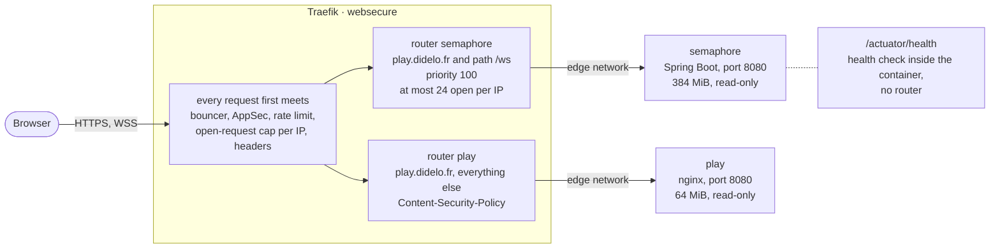

# 15. The game behind the edge

Date: 2026-10-24 · Status: accepted

## Context

[semaphore](https://github.com/Didelo-lilian/semaphore) is a word game with two parts built in its own repository: a static React front, and a Spring Boot backend that holds every room in memory and talks to browsers over a WebSocket. Both must be served at https://play.didelo.fr by the edge that already serves the other sites. Three things are new for this edge:
- a connection that stays open for the length of a game, through a bouncer, a WAF, two limits and a headers middleware that were only ever tried on short requests;
- an app whose health endpoint (the Spring actuator) must never be reachable from the internet;
- a front that needs scripts, fonts and styles from a React and MUI build, and one WebSocket, and nothing else.

The `deploy-app` script ([ADR 0009](0009-deploy-app-updates-without-approval.md)) rolls out the service that has the name of its stack, so each image needs a stack of its own.

## Decision

- **Two stacks**, [`stacks/semaphore`](../../stacks/semaphore/compose.yaml) (service `semaphore`, `ghcr.io/didelo-lilian/semaphore:main`) and [`stacks/play`](../../stacks/play/compose.yaml) (service `play`, `ghcr.io/didelo-lilian/semaphore-front:main`). Same recipe as `ds` ([ADR 0008](0008-serve-a-static-site-from-another-repository.md)): public image with a moving `main` tag, pulled on every start, only on the `edge` network, read-only file system with a tmpfs on `/tmp`, `no-new-privileges`, every capability dropped, a memory limit and a `wget` health check. The limits are 384 MiB for the backend (the JVM takes 75% of it for its heap; it uses about 115 MiB at rest) and 64 MiB for the front.
- **One host, two routers.** `/ws` goes to the backend, everything else on `play.didelo.fr` to the front. The backend's rule is `Host(...) && Path('/ws')`, an exact path rather than a prefix, with an explicit priority of 100 so that it wins whatever the length of the two rules. Nothing else of the backend is routed: `/actuator/health` and its variants end at the front, which answers its own 404 or page. The actuator is only for the container health check, which runs inside the container.
- **A cap of 24 open WebSockets per IP** on the `/ws` router. A WebSocket counts as an open request for as long as it lives. A room holds twelve players and each has one connection ([ADR 0003 of semaphore](https://github.com/Didelo-lilian/semaphore/blob/main/docs/adr/0003-rooms-the-state-machine-and-the-protocol.md)), so 24 is two full rooms behind one address (a family, a class, an office), reconnections included. It also bounds what one address can open on a JVM with 384 MiB: a connection holds one seat, so it bounds the rooms too.
- **The open-request cap of the edge becomes per IP.** `inFlightReq` groups requests by *request host* when it has no `sourceCriterion`, and every router has its own counter: the `in-flight` middleware of [`limits.yml`](../../stacks/traefik/dynamic/limits.yml) was a cap of 50 open requests shared by all the visitors of a router, not per IP as its comment and the README said. With WebSockets that is 50 players in total. It now sets `ipStrategy` explicitly (`depth: 0`, the connection's address); `ipStrategy: {}` is refused by Traefik, which wants at least one field in it.
- **The front's Content-Security-Policy is set by Traefik**, as a `headers` middleware on the `play` router, not by the image's nginx. It is one place to read and change, it can be tested here before any deploy, and it keeps the front image free of infrastructure names. The header replaces any CSP the nginx sends (checked), so the front does not need its own.

  `default-src 'none'; script-src 'self'; style-src 'self' 'unsafe-inline'; font-src 'self' data:; img-src 'self' data:; connect-src 'self' wss://play.didelo.fr; manifest-src 'self'; base-uri 'none'; form-action 'none'; frame-ancestors 'none'`

  It was built by loading a React 19, MUI 9 and design-system 1.0.0 build in a browser, then removing what was not needed. Scripts and fonts come from the origin. Vite inlines one small font as a `data:` URI. Emotion, which MUI uses, creates inline `<style>` elements at run time: with `style-src 'self'` alone the page loads with no theme, so `'unsafe-inline'` stays for styles only, never for scripts. The WebSocket is spelled out because `'self'` does not cover `ws:` and `wss:` in every browser. `frame-ancestors 'none'` overrides the `SAMEORIGIN` that every site gets.
- **Both stacks are deployable by `deploy-app`**: the script's list is now `ds`, `semaphore` and `play`, and so are the choices of the **Deploy app** workflow. The semaphore repository is to start it for each stack once its images are pushed, as design-system does for `ds`.
- **Two probes.** `https://play.didelo.fr` joins the blackbox HTTP probe like every site, and the existing alerts apply. The WebSocket handshake has a probe of its own, a `tcp` probe over TLS that sends the upgrade request as text and passes on a `101` status line, then closes: the HTTP prober never answered in a test (nothing after a minute, its own timeout is 10 seconds), because after a `101` the response is a stream that stays open. It goes through the whole edge and never reaches the actuator. `SiteDown` and `SiteSlow` cover both jobs; the public dashboard keeps showing the HTTP probes only. The game is added to the public status page in the `status` repository, after this change is live.
- **No DNS change**: the zone already has `*` pointing at the server, and Traefik gets the certificate for `play.didelo.fr` the first time the router exists.

## Consequences

Checked on a throwaway stack with the real flags, middlewares and `compose` files (Traefik, CrowdSec with AppSec, the backend image) and a stand-in front built from the design system:
- **A WebSocket crosses the whole chain.** The handshake gets a `101` through the bouncer, AppSec, both limits and the headers middleware. A connection idle for 200 seconds, longer than Traefik's default 60 s read and 180 s idle timeouts, is still open and answers; so is one that exchanges a message every 20 seconds. One survives four Docker provider reloads and a change of a dynamic file. No entry point timeout needed changing.
- **The limits.** Before the fix, 50 sockets from one container made a second container's socket answer 429; after it, 50 are accepted and the 51st is refused for that address only. With the cap, 24 of 27 sockets open, 3 get 429, another address gets in.
- **What the WAF sees.** AppSec inspects the HTTP handshake once and never the frames that follow: a frame that looks like an injection goes through, so the backend must validate every message itself (its messages are typed records, and one it cannot read gets an `error` answer). A normal handshake passes, `/ws?q=' OR 1=1--` gets the WAF's 403.
- **Origin and routes.** A handshake with another `Origin` gets the backend's 403, one with `https://play.didelo.fr` gets in. `/actuator/health`, `/actuator`, `/ws/x`, `/wsx`, `/ws/../actuator/health` and `/%2e%2e/actuator/health` never return the actuator.
- **The CSP** shows no violation in the browser with the final header, the WebSocket connects, and a third-party fetch, WebSocket, inline script, image and font each raise one. This is Chromium only, and the policy has to be re-checked when the front adds something (an analytics script, a hosted font).
- **The probe** passes in 0.2 s through the edge and fails once the backend stops.

Limits and what to watch:
- The `101` response carries none of the security headers; they are on the page that opened it, which is what browsers use.
- A deploy of the backend ends every WebSocket and loses every room, since they live in memory ([ADR 0003 of semaphore](https://github.com/Didelo-lilian/semaphore/blob/main/docs/adr/0003-rooms-the-state-machine-and-the-protocol.md)); during the overlap of the two containers Traefik can also send a handshake to the old one. A restart of Traefik drops every connection after 10 seconds. Sticky sessions and Redis come with the scaling step.
- The cap and the open-request limit are per address, and an IPv6 client can change address inside its /64: they stop a careless client, not a determined one. `ipv6Subnet` would group them, untested here.
- A change to `stacks/` is applied by the **Server** workflow with its approval, and `play` pulls an image that the semaphore repository must have published first: an apply before that fails to start `play`, and the probes alert.
- Opening a new origin in the front (a hosted font, an API) takes a pull request here.
