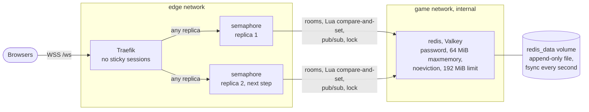

# 18. Redis for the game's rooms

Date: 2026-10-25 · Status: accepted

## Context

The backend of [semaphore](https://github.com/Didelo-lilian/semaphore) holds every room in memory ([ADR 0003 of semaphore](https://github.com/Didelo-lilian/semaphore/blob/main/docs/adr/0003-rooms-the-state-machine-and-the-protocol.md)), so there can be only one backend, and a deploy of it ends every game ([ADR 0015](0015-the-game-behind-the-edge.md): "Sticky sessions and Redis come with the scaling step"). [ADR 0008 of semaphore](https://github.com/Didelo-lilian/semaphore/blob/main/docs/adr/0008-rooms-in-redis-shared-by-replicas.md) moves the rooms to Redis so that two replicas can share them and a replica can be replaced without losing a game. What it asks of the server:
- one JSON value per room, changed by a Lua script that compares the room's `version` before writing (compare-and-set);
- publish and subscribe, so that a replica tells the others a room changed;
- `SET key value NX PX` as a short lock;
- a restart of Redis must keep the rooms, and nothing but the game may reach it.

This change only puts that Redis on the server. Nothing uses it until the backend change is merged and deployed, and the backend stack is not touched here.

## Decision

- **Valkey, not Redis.** Redis changed its licence with 7.4 (RSALv2 or SSPLv1, source-available rather than open source) and added AGPLv3 as an option with 8.0. [Valkey](https://valkey.io) is the fork of the last BSD release (7.2.4) kept by the Linux Foundation, under the BSD 3-clause licence, with the same protocol: Lua scripts (with `cjson`), pub/sub and `SET NX PX` all work, `valkey-cli` and the Redis clients speak to it unchanged (its `INFO` even says `redis_version:7.2.4`). The image is the project's own, `valkey/valkey:9.1.2-alpine`, the newest stable line (9.2 is still a release candidate). It is pinned **by digest** next to the tag, which makes a pull reproducible; Dependabot's `docker-compose` entry already reads `stacks/*` and bumps the tag and the digest together in its weekly pull request.
- **One stack, one service, both called `redis`**, in [`stacks/redis`](../../stacks/redis/compose.yaml), hardened like the others ([ADR 0015](0015-the-game-behind-the-edge.md)): read-only file system (only the `/data` volume is writable), every capability dropped (the process has none), `no-new-privileges`, a memory limit and a health check. It runs as `10002:10002` rather than the image's own `valkey` (999): a user that exists nowhere else on the server, so the password file can be `root:10002`, mode `0440`, without opening it to a system group (999 is `systemd-journal` there).
- **A password, `requirepass`, from a SOPS secret** ([ADR 0007](0007-secrets-with-sops-and-age.md)). `REDIS_PASSWORD` (64 hexadecimal characters, so it fits in a `redis://` URL as it is) is in `secrets/production.sops.yaml`. Ansible writes it to `/srv/stacks/redis/secrets/redis_password`, which Compose mounts as a secret, like the SMTP password. The server reads it at start with `--requirepass "$(cat …)"`: the password is in neither the Compose file nor `docker inspect`, and the command line of the container's first process shows the `$(cat …)` text, while Valkey replaces its own with `valkey-server *:6379`. The health check passes it in the environment (`REDISCLI_AUTH`), not as an argument. Valkey reads the password at start only and Compose does not see a bind-mounted file change, so Ansible also writes the SHA-256 of the password to the stack's `.env` and the compose file puts it in a label: **a new password recreates the container** in the run that writes it, even if a later task of that run fails (a handler would be lost then). The hash of a random 256-bit value tells nothing about it. A rotation is the runbook's: edit, merge, run **Server** with `force`. Without the password, `PING` answers `NOAUTH`; a wrong one, `WRONGPASS`. Protected mode is off in this image, so the password and the network are the two locks. `CONFIG SET dir` and the other protected settings are refused, which is the default.
- **The rooms survive a restart: append-only file, `appendfsync everysec`**, in the named volume `redis_data`. Every write is appended to the file and flushed once a second, and a start replays it. Periodic snapshots are off (`--save ""`): with the append-only file they would only copy it and fork the process for nothing. The file rewrites itself when it doubles past 64 MiB (the default). There is no backup: a room is short-lived, the backend gives its key a TTL, and losing the volume costs the games in progress, which a deploy costs today.
- **Memory: `maxmemory 64mb`, `noeviction`, `mem_limit: 192m`.** When Redis is full it **refuses the write** with an `OOM` error instead of dropping a key: an evicted room is a game that vanishes without a word, while a refused write is an error the backend can answer, with every other room still working. 64 MiB is far above what two backends can hold: I assume a room is a few KiB of JSON, to be measured when the backend writes them. The limit is three times that because `maxmemory` counts the data only, and the fork that rewrites the append-only file shares the parent's memory, then copies the pages the parent changes. **Budget**, from `free` on the server on 2026-10-25: 7,746 MiB in total, 6,435 MiB available with every stack running, no swap, 4 vCPUs. The limits add up to 2,240 MiB today (CrowdSec 384, monitoring 1,280, the backend 384, the front 64, `ds` 64, the socket proxy 64; Traefik and `hello` have none). The second backend (384 MiB) and Redis (192 MiB) add 576 MiB, which makes 2,816 MiB, 36% of the memory: with every limited container at its limit, 4.8 GiB would still be free for Traefik, `hello`, the kernel and the page cache. A backend takes about 115 MiB at rest, so the real figure is far lower.
- **A network of its own, `game`.** Docker has no network that two stacks can share unless one of them creates it: [`stacks/redis`](../../stacks/redis/compose.yaml) creates `game`, the way [`stacks/traefik`](../../stacks/traefik/compose.yaml) creates `edge`, and the playbook starts Redis before the backend. It is **`internal`** (no route to the outside), only Redis is on it for now, and the semaphore stack will join it, **in addition to `edge`**, in the two-replica change. Redis has no port published, no Traefik label and is not on `edge`, so the browser, Traefik and every other container are out of its reach.
- **Two replicas behind Traefik, with no sticky sessions** (the target, a later change). The handshake of a WebSocket reaches Traefik, which picks a replica; the room code only comes in the first message, after that choice, so Traefik cannot route by room, and a cookie that pins a browser to a replica would not help either: two players of one room are two browsers, so they land on different replicas in any case. The state therefore has to be shared, and once it is, any replica can serve a `rejoin`: after a deploy or the death of a replica the browser reconnects wherever Traefik sends it. The cap of 24 open connections per IP is enforced by Traefik before it picks a replica, so it still counts every connection of an address.
- **Not in `deploy-app`.** The script starts a second container next to the first one and removes the old one once the new one is healthy. Two Valkey processes on one append-only file would corrupt it. The service has the name of its stack, so the script could take it, but it stays out of the list on purpose: a new image reaches the server through Dependabot's pull request and the **Server** workflow, with its approval.
- **Down or unhealthy: partly covered, and the gap is written here.** What exists: `ContainerRestarting` fires when it starts three times in 15 minutes (a crash loop); and once the backend depends on it, a Redis that cannot answer should make the backend's health check fail (the Spring default when a Redis client is configured, to be checked in the backend change), so that Traefik stops routing to it and `SiteDown` fires for the WebSocket probe (the HTTP probe is answered by the front, which depends on neither). What does not exist: nothing notices a Redis that stays stopped, or runs but answers nothing, *before* the backend uses it: cAdvisor does not export the Docker health status, and Docker restarts a container that exits, never one that is unhealthy. A rule on the container's absence would close the gap, and the right moment is the backend change: editing `rules.yml` makes Ansible recreate the four monitoring containers (their config hash covers it), and this change applies the new stack and nothing else.

## Consequences

Checked on a throwaway stack with the real compose file and flags (Valkey 9.1.2 on Docker 29.9 in Docker-in-Docker, the server having 29.1.3):
- **Read-only and unprivileged.** Writing outside `/data` fails with "Read-only file system"; the process runs as 10002 with no capability and finds the password file (`root:10002`, `0440`); the container is healthy and no port is published.
- **The password is required.** `PING` without it gets `NOAUTH`, with a wrong one `WRONGPASS`, and the health check with a wrong one fails.
- **`edge` cannot reach it.** From a container on `edge` alone the name `redis` does not resolve and a TCP connection to its address times out; a container on `edge` *and* `game`, as the backend will be, connects; a container on `game` alone has no route to the internet. The first attempt ran on my laptop's Docker and proved nothing: its `DOCKER-USER` chain accepts every packet, which turns the isolation between networks off, and a container on `edge` got through. The server's chain is empty.
- **A rotation recreates it.** With the same password a second `up` recreates nothing; with a new password and its new hash the container is recreated, the old password is refused, the new one accepted and a room written before is still there.
- **The rooms survive.** A key is still there after `docker restart`, after a `kill -9` two seconds after the write, and after the container is removed and created again. Killed within the second that follows a burst of 200 writes, 5 of them were lost, which is what `everysec` promises: up to a second. Replaying a dataset of 58 MiB (45,000 keys) from the file took 0.7 s.
- **`noeviction` refuses, never evicts.** 200,000 writes of 1 KiB into the 64 MiB limit: 150,331 got `OOM command not allowed when used memory > 'maxmemory'`, `evicted_keys` stayed 0, the key written first was intact, and reads, deletes and publishes still worked.
- **The limit holds under a rewrite.** With 54 MiB of data overwritten at 35,000 writes a second during a rewrite of the append-only file (far more than the game will write), a 128 MiB limit was reached (127 MiB used) and a 192 MiB limit peaked at 97 MiB (sampled once a second); neither was killed.
- **What the backend needs works.** A Lua script compared a room's `version` and returned 1 once and 0 for the stale writer; `SET NX PX` took a lock and refused the second taker; a subscriber received a published message. One catch for the backend: `cjson` turns an empty array into `{}` (a room with `"players":[]` came back as `"players":{}`), so the script must read the `version` and store the JSON text it was given, never decode and encode the room.

Limits and what to watch:
- **One Redis, no replica and no failover.** When it is down nobody can create or join a room, and the games in progress stop. For a personal platform that is accepted; the rooms themselves are not lost, they are in the file.
- **An image bump or a rotation recreates it**, and every connection to it drops until it is back; the dataset is small, so that is about the time of a start.
- **A refused write is the backend's to handle.** It must answer an error to the player and carry on.
- **Nothing orders the start of Redis before the backend.** They are two Compose projects: after the 04:00 reboot, or an apply that recreates Redis, the backend can start first. It has to retry its connection until Redis answers.
- **A rotation of the password ends the games in progress**, because the backend holds the old one until it restarts too. Do it when nobody is playing. Until the backend uses Redis nothing else needs a restart.
- **The traffic between the backend and Redis is not encrypted**: it stays on an internal network of one host.
- **The host has `vm.overcommit_memory = 0`.** The usual advice for Redis is 1, and Valkey warns at start when it is not (not seen here: my test host has 1). With 6 GiB available and a dataset of at most 64 MiB, the fork is not at risk; the setting is host-wide, so it is left alone.
- **What the dry run of the Server workflow announces**: the new stack's files copied, the secrets directory created, and the start of the `redis` stack, which it cannot really run before the files exist, so it is reported as ignored. The password and its hash do not show in a dry run (it has no age key); nothing else changes, and the existing stacks are untouched.
