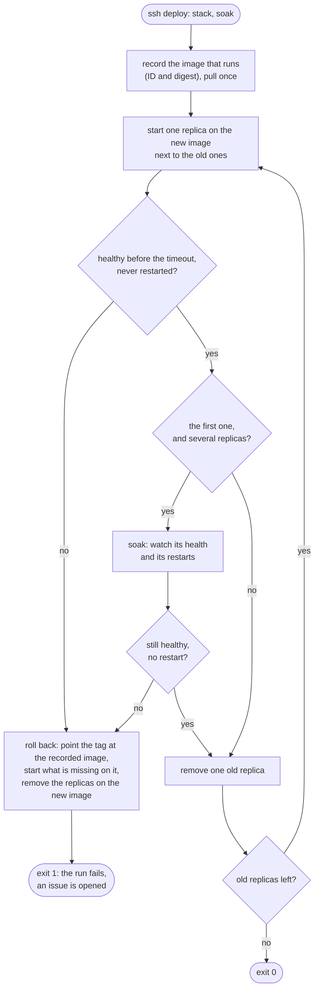

# 19. Rolling and canary deploys

Date: 2026-10-25 · Status: accepted

## Context

`deploy-app` ([ADR 0009](0009-deploy-app-updates-without-approval.md)) replaced a stack's one container by starting a second next to it. The game's backend is about to run as several replicas behind Traefik, with its rooms in Redis (the Game v0.4 milestone), and then a bad image must reach one replica only and go back without a person. Four facts shape that:
- the image tag moves on purpose (`:main`, [ADR 0008](0008-serve-a-static-site-from-another-repository.md)): by the time a deploy fails, the tag already names the failing image, so "the previous image" has to be recorded before the pull;
- a replica that restarts closes its WebSockets. Clients reconnect on their own and rejoin their room, which the next replica finds in Redis, so a restart costs a reconnection and no room;
- the script is the forced command of a key that is root-equivalent ([ADR 0009](0009-deploy-app-updates-without-approval.md)): it takes a stack from a fixed list and nothing it could run;
- the run is started by an App, so GitHub sends nobody an email when it fails.

## Decision

- **One replica at a time, one more than asked for during the switch.** The script lists the containers of the service, pulls once, and for each of them starts one more replica on the new image (`up --no-recreate --scale n+1`), waits for it, and removes one old replica. The capacity never falls under `n`, and Traefik only routes to healthy containers ([ADR 0009](0009-deploy-app-updates-without-approval.md)). Nothing pulls again after the first pull (`--pull never`): every replica of one rollout gets the image the first one got, even when the tag moves meanwhile.
- **The canary is the first new replica.** It must become `healthy` within 90 seconds without a restart, then it is watched for the soak, 120 seconds by default (the `soak` input of the workflow, or the second word of the command, digits only, under 1000). Each second the script reads the container: a restart, an exit or a health other than `healthy` ends the soak as a failure. The following replicas only have to become healthy. A stack with one replica (`ds`, `play`, and `semaphore` until it has two) has no soak and behaves as it did, except that a replica that fails is removed at once instead of at the next run.
- **The previous image is recorded before the pull**: the image ID the first old container runs (its digest is printed in the log). The tag cannot be trusted, and an image that a container runs cannot be pruned, so the ID is still there when it is needed.
- **A rollback points the tag back at that ID and starts what is missing with the Compose file as it is.** The first idea was a temporary override file with `image: repo@sha256:…`. It leaves no file behind, but a container created from it has another configuration hash than the same container created from the plain file, so the next **Server** run would recreate it (checked: a plain `up` recreated both containers that an override had created). `docker tag <id> <image>:main` has the same effect on what runs, creates containers that Compose sees as up to date, and has nothing to clean up; the next `pull` puts the tag where the registry has it. It then removes every container still on the failing image, after the restored ones are healthy. The script exits 1 once the rollback is done and 2 when the rollback itself failed.
- **The run fails where it can be seen, and an issue alerts.** The `ssh` step fails on a non-zero exit, so does the run. A second job, `alert`, runs on failure with `issues: write` only and opens an issue assigned to me, with the link of the run: an App started the run, so GitHub notifies nobody of it, and an assignment is notified.
- **The script is a file of its own**, `scripts/deploy-app`, that Ansible copies, instead of text inside `site.yml`: it is linted with shellcheck and run by `tests/deploy-app/run.sh`, in CI too. Two environment variables exist for those tests (the stacks directory and the health timeout); a restricted SSH key cannot set an environment.

## Consequences

Checked with the real `scripts/deploy-app` on a throwaway stack (`make test-deploy-app`, [`tests/deploy-app`](../../tests/deploy-app/run.sh), also run by CI): a local registry whose `main` tag moves as the real one does, a Traefik v3.7.16 in front, a service named like its stack with the stacks' real health check (faster: 1 second), and an image of a few lines of Python whose behaviour is baked in. Each case starts from two replicas of a good image, opens 20 long-lived requests (what a WebSocket is to Traefik) before the deploy and 20 more three seconds after the canary is healthy, then counts how many are still open. Docker 29.8.2 and Compose 5.5 on a laptop: the script has not run with the Compose that the server has (Ubuntu's `docker-compose-v2`), only with flags that have existed for a long time (`--scale`, `--no-recreate`, `--pull never`).

| Case | Exit | After | Open of the first 20 | Open of the 20 opened during the soak |
|---|---|---|---|---|
| Good image, soak 8 s, the registry's tag moves again during the soak | 0 | 2 replicas, both on the image the canary got (version 2 served while the tag named version 3) | 0 | 7 (the ones on the canary) |
| Image that exits at once | 1 | the same two containers, old version served, 3 s | 20 | none opened |
| Image that never becomes healthy | 1 | the same two containers, 4 s | 20 | none opened |
| Image still `starting` when the 6 s limit is up | 1 | the same two containers, 8 s | 20 | none opened |
| Image healthy, then exits 8 s after its start (soak 15 s) | 1 | the same two containers, old version served | 20 | 13 (the 7 on the canary died with it) |
| Canary good, second replica exits | 1 | two replicas on the old image, one of them the container that was never touched, old version served | 10 | 7 |
| One replica, good image (soak 30 s asked) | 0 | one replica on the new image, 2 s: no soak | 0 | none opened |
| One replica, image that exits at once | 1 | the same container, still serving | 20 | none opened |

The arguments are checked too: an empty command, an unknown stack, `ds;id`, `ds 1000`, `ds -1`, `ds 5 6` and `../ds` are all refused with exit 1 before anything runs.

What a rollback costs in dropped connections, with these numbers (a connection is cut when its replica goes, and Traefik sends new connections to a replica about two seconds after it is healthy, because it applies changes to its configuration at most every two seconds):
- **A canary that never starts or never gets healthy costs nothing.** Traefik never routes to it, and the old replicas are not touched: 20 of 20 connections stayed open.
- **A canary that fails during the soak costs the connections it took.** With two replicas it takes about a third of the new connections (7 of 20 here), and each of them is cut when it dies or is removed. The old replicas keep all of theirs. These clients reconnect on their own and `rejoin` their room, which any replica finds in Redis, so a rollback of the canary is one reconnection for about a third of the players who connected during the soak, none for the others.
- **A later replica that fails costs more, because the rollout had started.** The connections of the old replica already replaced were cut, as in any deploy (10 of the first 20), and the canary's are cut by the rollback. Of the second 20, 13 were cut (those on the replica replaced in the normal course and those on the canary) and 7, the ones on the replica never touched, stayed. The old image comes back on a new container, so a rollback here restarts one replica. A connection is cut at most twice, once when its replica is replaced and once when the rollback removes the new one.
- **A good deploy cuts every connection once**, in turn: all 20 of the first batch (0 left), and those on the old replicas among the second.

The case with a good canary and a failing second replica is the one that needs the recorded image: the registry's tag already names the new image, and the replica that was replaced is started again on the old one (it served version 1 again, from a container created after the registry had moved on).

Limits and what to watch:
- **After a rollback the tag still names the failing image.** The **Server** workflow pulls it too, so an apply before a fixed image is pushed puts it back. A fix is a new merge in the image's repository, which starts **Deploy app** again; a bad image that must stay out is pinned by a `sha-…` tag in the Compose file through a pull request, as before.
- **The soak sees what Docker sees.** It does not read a log or call an endpoint: an image that runs, answers its health check and misbehaves is not caught. The health check of Spring Boot's actuator and the alert on three restarts in 15 minutes (`ContainerRestarting`) are all there is, and a crash after the soak is a monitoring matter. A crash or a restart is seen within a second, but a health check that starts failing late in the soak is only seen if the soak is long enough: with the stacks' settings (30 s interval, 3 retries) Docker needs about 90 s to report `unhealthy`.
- **Health takes time to show.** Docker only decides `healthy` at the first probe, 30 seconds after the start with the stacks' settings, and `unhealthy` after three failed ones, so a rollout of two replicas takes about three minutes with the default soak.
- **An interrupted run** (a cancelled job, a dropped SSH connection) can leave one more replica than configured. The next **Server** apply scales the service back to `deploy.replicas` (checked: a plain `up` removed the extra replica).
- **Every replica is told apart by what it runs, not by a name**: the old ones are the containers present when the script starts. A service whose old replicas ran different images (a rollout stopped halfway) is rolled back to the image of the first one.
- **A service needs a health check**: without one the container never reports `healthy` and the deploy fails.
- The previous image stays on the server until `docker image prune`, as before.
