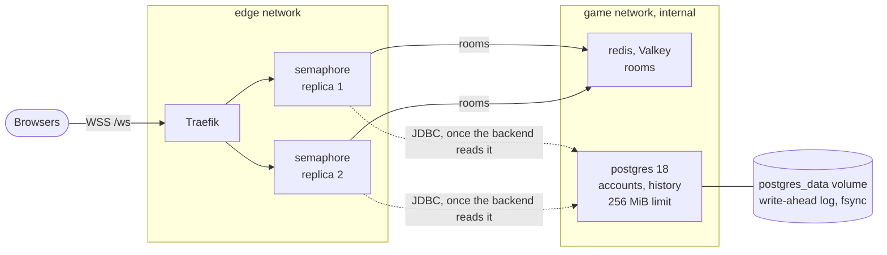

# 21. Postgres for accounts and game history

Date: 2026-10-25 · Status: accepted

## Context

The game keeps nothing that has to outlive a game: its rooms are in Valkey for a day at most ([ADR 0018](0018-redis-for-the-games-rooms.md)), and losing them costs the games in progress. What comes next does outlive them: accounts (sign-in with GitHub or Google), the history of finished games and a leaderboard (the milestones Game v0.6 and v1.0 of [semaphore](https://github.com/Didelo-lilian/semaphore)). That needs a relational database that survives restarts and that nothing but the backend can reach, next to Valkey.

This change only puts that database on the server and hands its address to the backend. Nothing reads it until the backend does: [`semaphore`](https://github.com/Didelo-lilian/semaphore) adds Flyway and a data source in a separate change.

## Decision

- **A Postgres of its own, not shared.** The first plan imagined one Postgres shared with a workflow tool; that tool is not deployed. One instance per purpose keeps a failure, a version and a password from reaching other things, and the data of the game is small. If a second consumer comes, it gets a database and a role in this instance or a stack of its own, and a new ADR.
- **PostgreSQL 18, `postgres:18.6-alpine` pinned by digest**, the newest stable major (19 is not on Docker Hub yet). Dependabot's `docker-compose` entry bumps the tag and the digest together, **but not the major**: a new major cannot read the data directory of the old one, so moving from 18 to 19 is a migration (dump and restore, or `pg_upgrade`) with its own change, and `dependabot.yml` ignores `semver-major` for `postgres`.
- **One stack, one service, both called `postgres`**, in [`stacks/postgres`](../../stacks/postgres/compose.yaml), hardened like the others ([ADR 0015](0015-the-game-behind-the-edge.md)): read-only file system (the data volume, the socket and `/tmp` are writable), every capability dropped, `no-new-privileges`, a memory limit and a health check. It runs as `70:70`, the image's own `postgres`, because `initdb` looks the running user up in `/etc/passwd` and an id made up for the occasion would not start; 70 is assigned to no user or group on a stock Ubuntu 26.04, so the password file can be `root:70`, mode `0440`, without opening it to a system group. The health check is `pg_isready` **over TCP**: during the first start the image runs a temporary server that listens on the socket only, and a check on the socket would report healthy before the initialisation is done.
- **The `game` network again, and nothing else.** The stack joins the internal network that [stacks/redis](../../stacks/redis/compose.yaml) creates (`external: true`, and the playbook starts Redis first). No port is published, there is no Traefik label, and the stack is not on `edge`: the browser, Traefik and every other container are out of its reach. The backend joins `game` already.
- **Two roles, and the backend gets the weaker one.**
  - `postgres`, the superuser: the image insists on a password for it, so it has one (`POSTGRES_ADMIN_PASSWORD`), but `pg_hba.conf` rejects it from the network ([`20-hba.sh`](../../stacks/postgres/initdb/20-hba.sh)): it is only reachable by `docker exec` over the local socket, which is how Ansible sets the passwords.
  - `semaphore`, the backend's role: `LOGIN`, no superuser, no `CREATEDB`, no `CREATEROLE`, at most 30 connections (the server has 40, two replicas hold ten each, Flyway one), and **owner of the `semaphore` database** ([`10-semaphore.sql`](../../stacks/postgres/initdb/10-semaphore.sql)). Since PostgreSQL 15 the `public` schema belongs to the database owner, so this one role can create the tables, which is what **Flyway needs**: it migrates when the backend starts, with the same credentials. A second role that only reads and writes rows would add nothing here: the process that holds it also runs the migrations, so both passwords would sit in the same place. The role cannot reach another database (`PUBLIC` loses `CONNECT` on `postgres` and `template1`), so a leak of its password exposes the game's data and nothing else.
- **Passwords from SOPS, set by Ansible on every run, not at the first start.** `POSTGRES_PASSWORD` and `POSTGRES_ADMIN_PASSWORD` (64 hexadecimal characters each, `openssl rand -hex 32`) are in `secrets/production.sops.yaml` ([ADR 0007](0007-secrets-with-sops-and-age.md)). The image reads the superuser's password at the very first start only, and a role's password lives in the database, not in a file the server rereads. So the init script creates `semaphore` **without** a password (it cannot log in over the network until it has one) and, after the stacks are up, the playbook runs `ALTER ROLE … PASSWORD` for both roles through `docker exec`, with the value in the environment and the statement on stdin, so that it shows in no process list, no log (`log_statement` is `none`) and no `docker inspect`. The backend's stack starts **after** that task (the playbook starts the data stores, sets the passwords, then starts the apps), so a replica never starts with a password the database does not have yet. Setting a password to its own value changes nothing for the clients, so the task runs every time and prints nothing. The consequence is a **rotation that does not restart Postgres**: the issue that asked for this stack pictured a rotation recreating both containers, as for Valkey, which reads its password at start; here only the backend restarts.
- **The backend gets one secret file with its whole address.** Ansible writes `jdbc:postgresql://postgres:5432/semaphore?user=semaphore&password=<password>` to `/srv/stacks/semaphore/secrets/spring.datasource.url` (`root:10001`, `0440`), Compose mounts it as a secret and Spring Boot reads the directory as configuration (`SPRING_CONFIG_IMPORT=configtree:/run/secrets/`, already set for Valkey): the file name is the property **`spring.datasource.url`**, which Flyway and the connection pool both use. One file instead of three (`url`, `username`, `password`) is one thing to write and to keep consistent, and the driver reads the credentials from the URL. The password is nowhere in a Compose file or in `docker inspect`. Spring reads the file at start only, so the label of the backend carries the hash of the two passwords (Redis and Postgres) and **a new password recreates the replicas**, like Redis.
- **Durability: the write-ahead log.** Postgres writes a change to its log and flushes it (`fsync`, `synchronous_commit` on, the defaults) before it answers a commit, so a committed row survives a `kill -9` and a power cut, which Valkey's append-only file flushed every second does not promise. The data and the log are in the named volume `postgres_data` (the image keeps them below `/var/lib/postgresql/18/docker`); the log is capped (`max_wal_size=256MB`). **There is no backup yet**: [issue #94](https://github.com/Didelo-lilian/infra/issues/94) covers encrypted dumps off the server and a restore drill. Accounts are the first data that cannot be rebuilt, so **the Game v1.0 release must not ship without that issue done**, and it is better done before real players sign in.
- **Memory: `mem_limit: 256m`, `shared_buffers=64MB`, `max_connections=40`.** The data of a game is a few small tables; 64 MiB of shared buffers hold all of it, and the rest of the limit is for the backends (about 10 MiB each) and the maintenance work (`maintenance_work_mem=32MB`). **Budget**, from [ADR 0018](0018-redis-for-the-games-rooms.md) and [ADR 0020](0020-two-replicas-of-the-backend.md): 7,746 MiB in total, 6,435 MiB available with every stack running, and 2,816 MiB of limits with the second backend and Valkey. Postgres adds 256 MiB, which makes **3,072 MiB, 40% of the memory**: with every limited container at its limit, 4.6 GiB would still be free for Traefik, `hello`, the kernel and the page cache. It uses about 12 MiB idle.
- **A slow statement shows in the logs** (`log_min_duration_statement=1000`), and `random_page_cost=1.1` tells the planner the disk is an SSD.
- **One alert: `PostgresMissing`**, when no Postgres container has been seen for 2 minutes, with a promtool test, like `RedisMissing`. Editing `rules.yml` makes Ansible recreate the four monitoring containers (their config hash covers it): the dry run of the change shows it.
- **Not in `deploy-app`.** Two Postgres processes on one data directory would corrupt it, and a new image reaches the server through Dependabot's pull request and the **Server** workflow, with its approval.

## Consequences

**Order.** Applying this change does nothing the player can see: Postgres starts and waits, the passwords are set, and the backend's address is a file that the image running today does not read. It does, however, **recreate the two backend replicas once** (a new secret and a new hash in the label), a few seconds without the game, and the games in progress end, as at every deploy until now; and it recreates the monitoring containers. The image that reads `spring.datasource.url` can be deployed before or after this change: without the file, the backend must start without a database (the persistence change of semaphore does that), and once the file is there the next restart connects.

Checked with the real Compose files of `stacks/redis`, `stacks/postgres` and `stacks/semaphore` (Docker-in-Docker on 29.9, the server having 29.1.3), the real image of the backend (`ghcr.io/didelo-lilian/semaphore:main`) and the Ansible tasks of the playbook run against that Docker:
- **It starts in 5 seconds and is hardened.** Healthy after the initialisation; the process is `70`, with no capability; writing outside the data volume, the socket directory and `/tmp` fails with "Read-only file system"; no port is published; the container is on `game` only.
- **The passwords are required and nowhere to be read.** Over the network the superuser is rejected whatever the password (`pg_hba.conf rejects connection`); `semaphore` without a password gets `no password supplied`, with a wrong one `password authentication failed`, and with the right one connects to its database and to no other (`postgres` and `template1` answer `User does not have CONNECT privilege`). The password is in no `docker inspect` and in no line of the server's log.
- **The backend's role can do its job and no more.** It creates and fills tables in its database, it cannot create a role (`Only roles with the CREATEROLE attribute may create roles`) or a database (`permission denied to create database`), and it owns the `public` schema.
- **The address works with the real driver.** The URL in the secret file, read from a file as `configtree` will, connects with pgjdbc 42.7.14 on Java 25 and answers a query. The backend image started next to it with both secret files mounted (`root:10001`, `0440`, readable by its user) and both replicas became healthy, still reporting `rooms: redis redis:6379`: the extra file is ignored until the image reads it.
- **The data survives.** A row is still there after `docker restart`, after a `kill -9` right after the commit, and after the container is removed and created again with the volume kept (the log says it skips the initialisation); the password set by `ALTER ROLE` survives all three, since it is in the database.
- **A rotation restarts the backend and not Postgres.** With a new password set through the playbook's task, the new hash and the new address file: Postgres kept its container, both replicas were recreated, the old password was refused and the new one connected through pgjdbc. The Ansible task itself (`docker exec`, the password in the environment, the statement on stdin, `\getenv`) ran against that Docker and set both passwords.
- **`edge` cannot reach it.** From a container on `edge` alone the name `postgres` does not resolve and a TCP connection to its address times out. The server's `DOCKER-USER` chain is empty, like the Docker-in-Docker's; the laptop's is not, which is why the check runs there.
- **The limit holds.** 28 clients of `pgbench` (scale 10, a table of about 150 MB, more than the buffers) for 36 seconds: 66,928 transactions, none failed, 1,865 per second, a 15 ms average, and 131 MiB at the peak out of 256, without an out-of-memory kill. That is a laptop, so the figure says that the limit is far from tight, not what the server will do.

Limits and what to watch:
- **One Postgres, no replica and no failover.** While it is down nobody can sign in or see a history; the game itself, which keeps its rooms in Valkey, must not depend on it (the backend's health check leaves it out, like Valkey's, [ADR 0008 of semaphore](https://github.com/Didelo-lilian/semaphore/blob/main/docs/adr/0008-rooms-in-redis-shared-by-replicas.md)). `PostgresMissing` covers a container that is gone, not one that runs and answers nothing: cAdvisor exports no health status.
- **No backup until [issue #94](https://github.com/Didelo-lilian/infra/issues/94).** The volume is the only copy.
- **An image bump recreates it** and every connection to it drops until it is back, a few seconds; the backend's pool reconnects.
- **A rotation of the superuser's password** is applied by the same task and needs nothing else; **a rotation of the backend's** needs the backend to restart, which the hash does, and ends the games in progress: rotate when nobody is playing. The runbook has the steps.
- **A change of `stacks/postgres/initdb` does not apply to a data directory that exists.** Those scripts run once, at the first start. A change to the roles or to `pg_hba.conf` of the running server is made by hand with `docker exec` and written in the script as well, or in the runbook.
- **The traffic between the backend and Postgres is not encrypted**: it stays on an internal network of one host, like Valkey's.
- **The superuser's password protects nothing at the moment** (the network rejects it), so it is a second lock, not the first: the first is the file `pg_hba.conf`, which the init script wrote once.
- **What the dry run of the Server workflow announces**: the new stack's files copied, the secrets directory created, the changed semaphore compose, the monitoring configuration and the start of the `postgres` stack, which it cannot really run before the files exist, so it is reported as ignored. The passwords and the hash do not show in a dry run (it has no age key).
