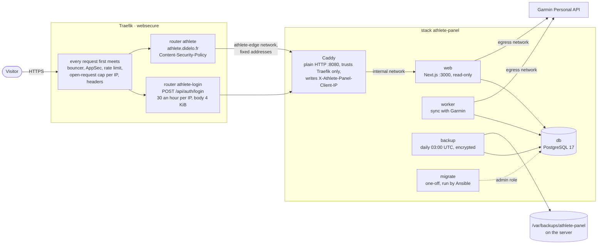

# 23. athlete-panel behind the edge

Date: 2026-11-02 · Status: accepted

## Context

[athlete-panel](https://github.com/bidulelabs/athlete-panel) is a self-hosted training app for one athlete: a Next.js web app, a worker that syncs with Garmin's Personal API, PostgreSQL 17, an owner login and an API for an external agent. It is published as an image (`ghcr.io/bidulelabs/athlete-panel`, amd64 only) with a Compose file of its own, which brings a public Caddy that gets its certificate itself and a controller script that manages the whole installation. Neither fits here: Traefik owns ports 80 and 443 and the certificates, and the server is managed by Ansible.

Three things in the app shape the stack:
- **The client address.** With `TRUST_PROXY_CLIENT_IP=true` the app limits the login attempts per address (20 in 15 minutes) and takes that address from the header `X-Athlete-Panel-Client-IP`, which the proxy in front of it must write; it answers 503 without it. Traefik cannot copy the remote address into a header from labels.
- **Two database roles.** The web app and the worker only get a role that owns the data. A separate administrator creates that role and applies the migrations (`pnpm db:migrate`), and nothing else may hold that password. The web app is not healthy on a schema that is not its release's.
- **Keys that cannot be recovered.** `ENCRYPTION_KEY` encrypts the Garmin credentials; a backup key of its own encrypts the archives, and the app refuses to use the same one for both.

The owner's login password is the owner's alone: it never goes in this repository, in SOPS or in a log.

## Decision

**A stack of its own, with its own Postgres.** `stacks/athlete-panel` holds the database, the web app, the worker, a one-off migration service, the backup service and Caddy. The database is PostgreSQL 17, the major the app is written for (the game's Postgres is 18, with other roles and other data), alpine variant, pinned by digest; Dependabot ignores a new major, which cannot read the data directory of the old one. The app image is pinned by tag and digest and Dependabot bumps both in a pull request of its own (an update runs migrations on the owner's data, so it is read alone and applied after a backup). Every service has no capability, `no-new-privileges`, a read-only file system with a tmpfs for what it writes, and a memory limit.

**A minimal Caddy, internal.** Caddy has no TLS (`auto_https off`, no admin API) and does one job: it writes `X-Athlete-Panel-Client-IP` from the address of the client. It trusts `X-Forwarded-For` only from Traefik, whose address is fixed, and reads it from the right (`trusted_proxies_strict`), so a value the client sent never counts; the header is set, never added to, so a client cannot choose it either. Traefik keeps the TLS, the certificate, the bouncer, the WAF and the limits.

**A network of its own between Traefik and Caddy.** The `edge` network gets its subnet from Docker, so Caddy could not name Traefik's address in its configuration, and pinning it would mean recreating a network that every site is attached to. Trusting the whole `edge` would also let any container on it, the game's included, choose a client address. So the Traefik stack creates `athlete-edge`, like it creates `metrics` for Grafana: subnet `172.30.45.0/28`, Traefik at `172.30.45.2`, Caddy the only other member, at `172.30.45.3` (fixed too: after a reboot Docker hands out the free addresses in order, and a Caddy that came up before Traefik would take Traefik's). Caddy trusts the first address. Traefik routes there through `traefik.docker.network`. `tests/athlete-panel/run.sh` fails if the Caddyfile and the Traefik compose disagree on the address. The change recreates Traefik once, at the first apply: a few seconds without any site.

**Three networks inside.** `internal` has no route out and holds the database, Caddy and every service that talks to the database. `egress` is a plain bridge with a route out, joined by the web app and the worker only, because Garmin's API (`personal.connectapi.garmin.com`) is called from both. The database, the backups and Caddy cannot reach the internet. A name-based allow-list would need a proxy, which is not worth it for one app.

**Secrets from files, never from the environment of the Compose file.** SOPS holds four generated values: the two database passwords (`openssl rand -hex 32`, URL-safe as the app requires), `ENCRYPTION_KEY` and the backup key (32 random bytes, base64). Ansible writes them as files owned by a user of its own, 10010 (the images run as `node`, 1000, which on the host is a login user): the database reads its administrator password through the group, and the backup key is readable by its owner only, which the app checks. `bin/env.sh` builds `DATABASE_URL` and the keys from those files and runs the command, so no secret is in the Compose file, in `docker inspect` or on a command line (the test checks it). Only the migration and restore services get the administrator password. The owner's login password is chosen by the owner and set once with a command on the server that reads it from a prompt (the runbook): it never touches the repository.

**Migrations before the app, by Ansible.** The **Server** workflow starts the database, waits for it, runs the migration service (`pnpm db:migrate` with the administrator role: it creates the runtime role, applies what is new and refreshes the grants, and changes nothing when there is nothing to do), and then starts the rest. The app is not deployed by **Deploy app**: the worker and the migrations must restart together, and a few seconds of outage are acceptable. The old web app and worker keep running while the migration runs on the new image, so a migration that is not backward compatible fails a request or two in that window.

**Backups: encrypted, local, daily.** The backup service takes one at start and one every day at 03:00 UTC, and keeps seven daily and four weekly (the app's retention). Each archive holds the database dump, the matching source of the image and its metadata, encrypted with the backup key (AES-256-GCM) and read back and authenticated before the app counts it as done. It lands in `/var/backups/athlete-panel` (0700, owned by 10010; the app refuses another mode or owner). The service is unhealthy when the newest archive is more than 26 hours old. `restore-test` restores the newest archive into a database that lives for the length of the run and drops it; the live database is never touched.

**The edge.** A router for `athlete.didelo.fr` behind the usual middlewares, with the policy of the app's own Caddyfile as `Content-Security-Policy` (scripts and styles of Next.js are inline) and the `Via` header Caddy adds removed. The login has a router of its own, as the game's sign-in has: 30 an hour per address after a burst of 10, and a body of 4 KiB at most; the app's own limit stays behind it. The edge's headers (HSTS, `nosniff`, referrer, permissions) do not conflict with the page.

**The WAF needs no exemption.** The app only uses GET and POST: its pages, its API routes and its agent CLI were read, and none sends PUT, PATCH or DELETE, the methods rule 911100 of the CRS blocks ([ADR 0013](0013-a-waf-in-the-edge-that-fails-open.md)). `tests/crowdsec-waf/run.sh` posts what the app posts (the login, a Garmin key, workouts with free text: apostrophes, quotes, `<`, `&`, SQL words) and they pass, while a script tag and a SQL injection in a note are blocked and a PUT, PATCH or DELETE on this host stays blocked. If a release starts to use one of them, the exemption is a `pre_eval` hook limited to this host and `/api/`, and nothing wider.

**Supervision.** The probe of the site targets `/api/health`, which checks the database schema, so the existing alerts cover it (down, slow, certificate). An alert fires when fewer than five of the stack's containers run. cAdvisor exports no health status, so **a worker that runs and does nothing, or a backup loop that fails every night, is not seen by Prometheus**; the container health checks show it in `docker ps`, and [#112](https://github.com/Didelo-lilian/infra/issues/112) is open to make them alert.

## Consequences

- **The app calls itself a developer preview.** Its README says public HTTPS, recovery off the host and the Garmin integration with the owner's account are deployment gates its author has not verified. This stack is where the first two get exercised; the owner checks the third.
- **Local backups do not survive the loss of the VPS.** They are on the same disk as the database. They protect against a bad migration, a deleted record or a corrupted database, not against the server. The copy off the server is [#94](https://github.com/Didelo-lilian/infra/issues/94), and until it exists the owner's own copy of the keys is the only thing that outlives the server.
- **A lost `ENCRYPTION_KEY` makes the Garmin credentials unrecoverable**: a backup cannot bring it back, and the app has to be connected to Garmin again. The key and the backup key go in the owner's password manager, and not in the backups' directory.
- **IPv6 clients share one address.** Docker's userland proxy hands Traefik's `[::]:443` connections over from the bridge gateway, so every IPv6 visitor reaches the edge as `172.22.0.1` (measured with `curl -6` from the server: `ClientHost` is the gateway). This holds for every site, and for the login here it means one shared bucket for all IPv6 clients, at the edge and in the app: a bot on IPv6 can lock the owner out of the login if the owner is on IPv6 too, though it cannot guess a password faster than the app's limit allows. [#113](https://github.com/Didelo-lilian/infra/issues/113) is open to keep the real address.
- **Garmin's API is the only outbound destination, but the web app and worker can reach any.** The route out is not filtered.
- **The image is 870 MB**, pulled once per digest.
- The dry run of the **Server** workflow cannot read the secrets, so it does not show their creation or a rotation (the same shortcut as for the other stacks): run the workflow with `force` for a rotation, as the runbook says.
- Memory: about 1.5 GiB of limits for five services, against the 5.8 GiB the server had free when this was written.
